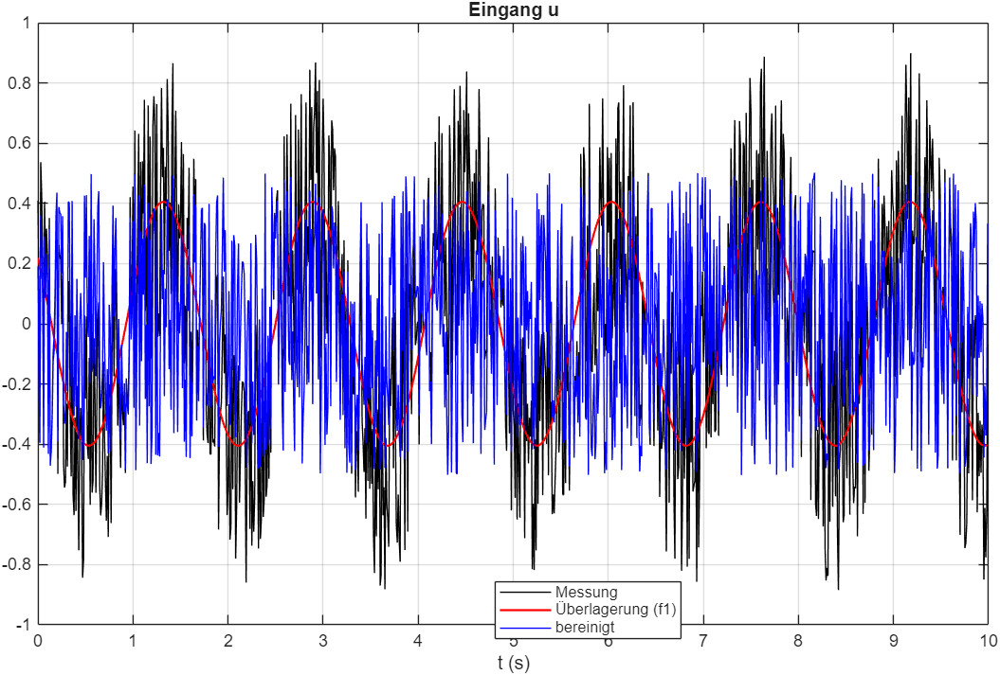
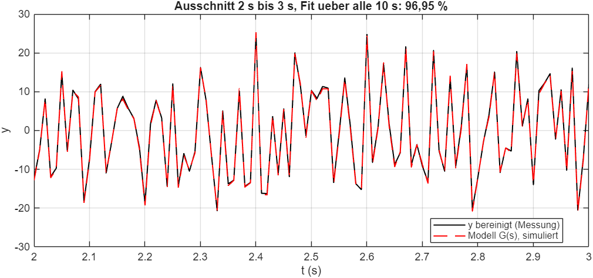
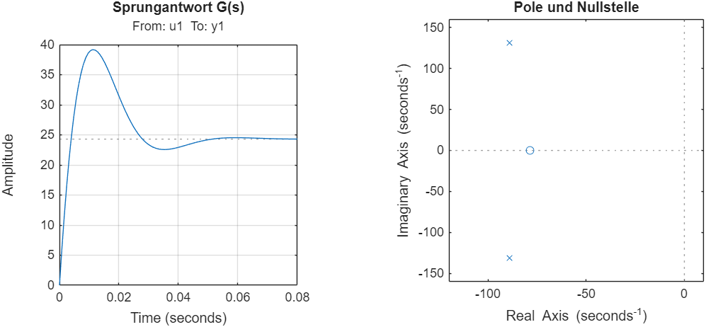

# Systemidentifikation aus verrauschten Messdaten

Aufgabe Typ 1 aus Systemidentifikation (IDS), M.Sc. Mechatronik, FH Wiener Neustadt, SS 2026. Einzelarbeit, das Paper dazu ist [paper_systemidentifikation.pdf](paper_systemidentifikation.pdf).

Gegeben sind Eingang u(t) und Ausgang y(t) eines unbekannten Systems, 10 s mit Ts = 10 ms. Beiden Signalen ist eine Störung überlagert. Die Form ist eine von drei bekannten, welche, weiß man nicht:

- f1(t) = A cos(4t + phi)
- f2(t) = a exp(-t²/b)
- f3(t) = a ln(sqrt(t) + 0.7)

Ziel: Störung finden und abziehen, dann die Übertragungsfunktion G(s) schätzen.

## 1. Störung entfernen

`aufgabe_type1_stoerung_entfernen.m`

Alle drei Modelle werden an u und an y angepasst, mit zwei Methoden:

- Kleinste Quadrate über die Pseudoinverse. f1 als c1 cos(wt) + c2 sin(wt) geschrieben ist linear in c1, c2. f3 ist sowieso linear. Bei f2 ist b nichtlinear, darum ein Raster über b und für jedes b das a per KQ.
- fminsearch direkt auf die Fehlerquadratsumme (RSS), Startwerte aus den KQ-Lösungen. Bei f2 wird log(b) optimiert, damit b positiv bleibt.

Beide Methoden kommen auf dieselbe RSS, das ist eine gute Kontrolle. Für u gewinnt f1 deutlich:

| Kanal u | f1 | f2 | f3 |
|---|---|---|---|
| RSS | 84.3 | 163.9 | 165.7 |



Schwarz die Messung, rot die geschätzte Sinusstörung (A ≈ 0.4), blau das Signal nach dem Abziehen.

Bei y ist die Störung klein gegen die Systemantwort, die drei Modelle liegen fast gleich auf (RSS um 1.37e5). Gewählt wird auch dort f1.

## 2. Übertragungsfunktion

`aufgabe_type1_sysid_followup.m`

`tfest` aus der System Identification Toolbox auf die bereinigten Daten, Vergleich der Ordnungen über die RSS der Prädiktion:

| np | nz | RSS |
|---|---|---|
| 2 | 1 | 126.7 |
| 2 | 2 | 126.7 |
| 3 | 2 | 112.4 |

Die zweite Nullstelle bei (2,2) bringt nichts. (3,2) ist etwa 11 % besser, braucht aber zwei Parameter mehr. Genommen wird das einfachere Modell (2,1):

```
         7804 (s + 78.5)
G(s) = -----------------------
       s² + 178.2 s + 25200
```

- Pole: s = -89.1 ± j131, also ωn = 158.8 rad/s (25.3 Hz) und ζ = 0.56
- Nullstelle: s = -78.5
- Verstärkung: G(0) = 24.3
- Fit auf die Messdaten: 96,95 %





## Ausführen

MATLAB mit System Identification Toolbox (zuletzt getestet mit R2025a):

1. `aufgabe_type1_stoerung_entfernen.m` schreibt `type1_bereinigt_workspace.mat`
2. `aufgabe_type1_sysid_followup.m`
3. `readme_plots.m` für die Bilder in `docs/`

`2026_Type1_nr1.mat` sind die Messdaten aus der Aufgabe (Variablen t, u, y).
